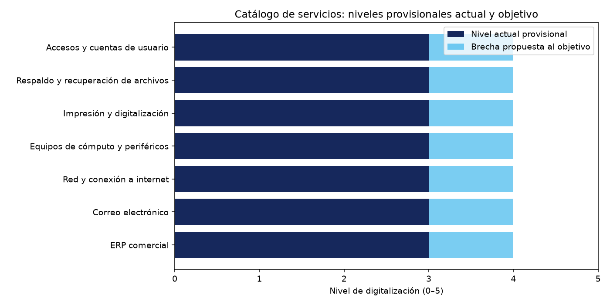
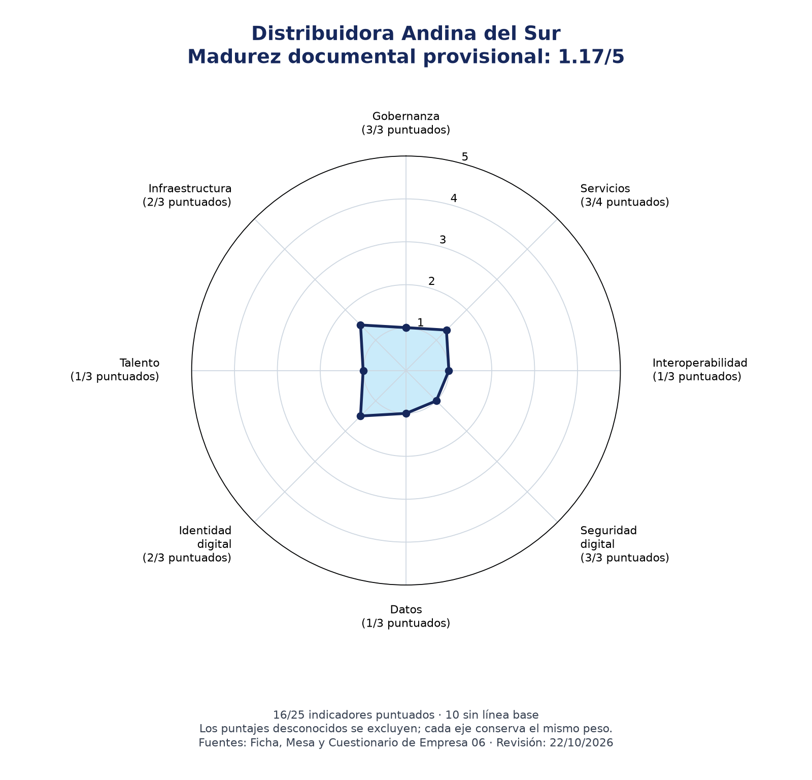

## 6.1 Situación actual del gobierno digital

**Organización:** Distribuidora Andina del Sur S.A.C. — Empresa 06, caso ficticio del curso.

**Aportes:** Personas 1 y 2. Integración documental: Sofxx7.

**Corte de revisión documental:** 22 de octubre de 2026. Esta fecha identifica la revisión del equipo; no reemplaza las fechas de medición ausentes en los insumos.

### 6.1.1 Marco conceptual y alcance

El diagnóstico aplica el enfoque del curso: la transformación requiere organizar servicios, responsabilidades, información y controles alrededor del usuario. La empresa es privada; se usa la equivalencia empresarial de los seis componentes explicados en la [teoría de Semana 11](https://github.com/OscarJimenezFlores/PETI/blob/5a1cb79deb1dc1cb6508082f7b786f682bdd3d35/SEMANA-11/1-TEORIA.md#1-qué-es-gobierno-digital-y-qué-no-es), sin atribuirle automáticamente las obligaciones propias de una entidad pública.

| Componente | Aplicación al caso |
|---|---|
| Identidad digital | Autenticación de clientes y trabajadores, correspondencia de cuentas y segregación de permisos para registrar y aprobar. |
| Servicios digitales | Atención de solicitudes de usuarios y servicios al cliente; la digitalización debe comprobarse en el recorrido completo, además de identificar los sistemas utilizados. |
| Arquitectura digital | Relación entre los procesos de compras, almacén, ventas, cobranza, pagos y contabilidad, sus datos, aplicaciones e infraestructura. |
| Interoperabilidad | Intercambio verificable entre ERP, aplicaciones y terceros; eliminación de recaptura y reutilización de documentos ya disponibles. |
| Seguridad digital | Gestión de riesgos, accesos, incidentes, respaldos, recuperación y aplicación de políticas. |
| Datos | Responsables del dato, calidad, conciliación de inventarios y decisiones sustentadas en información verificable. |

El alcance comprende ocho ejes y 25 indicadores registrados en [GD03_ejes.csv](GD03_ejes.csv). La evidencia son documentos del caso, revisados en la versión del repositorio docente indicada en las referencias. No se han realizado entrevistas, recorridos de servicio ni comprobaciones de controles en sistemas. Los hallazgos documentales se aceptan como hechos del caso según la ficha; se mantienen visibles sus límites de fecha, alcance y medición.

La [Ficha, sección B](https://github.com/OscarJimenezFlores/PETI/blob/5a1cb79deb1dc1cb6508082f7b786f682bdd3d35/SEMANA-11/RECURSOS-TALLER/EMPRESA-06-distribuidora-andina-sur/FICHA.md#b-estructura-y-gobierno) ubica a TI bajo Administración y Finanzas y describe un comité sin actividad durante el último año. El diagnóstico atiende especialmente al control de compras y pagos, la conciliación del inventario y la continuidad del servicio, que son necesidades expresadas en el caso.

### 6.1.2 Catálogo de servicios y su nivel de digitalización

La mesa de servicio reconoce siete servicios y enumera cinco canales generales: teléfono interno de TI, grupo de mensajería del personal, correo de soporte, atención presencial en TI y pedidos verbales de gerencia. El documento no desglosa qué canal se usa para cada servicio; por ello, el CSV conserva expresamente esa limitación. Tampoco existe una herramienta formal de gestión de servicios, el registro se completa en una hoja de cálculo al final del día y la jefatura indica que la atención real supera lo anotado.

Se proponen provisionalmente niveles actuales de 3 y objetivos de 4 para los siete servicios. La hipótesis actual refleja interacción por canales electrónicos y presenciales, sin evidencia de un flujo digital integral por servicio. El objetivo supone que la interacción del usuario —solicitud, seguimiento y cierre— pueda completarse en un canal digital; no implica que el trabajo técnico interno nunca requiera intervención presencial. La escala del curso mide el recorrido del usuario, no la mera existencia de un sistema. Los niveles deben contrastarse mediante recorridos antes de declararlos finales.

El volumen anual por servicio no está disponible en las fuentes revisadas. La mesa reporta 1 929 registros globales e incompletos; no corresponde repartirlos entre los siete servicios. El volumen y los conteos de documentos permanecen vacíos en el catálogo hasta obtener datos verificables.

La mesa declara metas sin firma ni medición: ERP «atención el mismo día», equipos «48 horas» y accesos «24 horas». Para correo declara disponibilidad permanente y para red 99 % de disponibilidad; ninguna de estas dos cifras es un tiempo de atención. No se informa meta de tiempo para impresión ni para respaldo/recuperación; el horario de respaldo no está definido.

### Indicadores globales de calidad del registro

| Hecho reportado por la mesa | Cálculo | Resultado |
|---|---:|---:|
| Registros que siguen abiertos | 70 / 1 929 | 3,6 % |
| Registros sin tipo anotado | 595 / 1 929 | 30,8 % |
| Registros sin prioridad | 231 / 1 929 | 12,0 % |

El registro abierto más antiguo tenía 210 días. La jefatura estima verbalmente que se atiende el doble o triple de lo que se registra; de forma indicativa, eso implicaría que el registro representa aproximadamente entre un tercio y la mitad de la atención, pero no constituye una medición. Estos datos caracterizan el registro global de la mesa; no son volúmenes anuales de cada servicio.

Como señales adicionales de demanda, la mesa reporta 75 bloqueos de usuario por contraseña, 22 episodios de lentitud del sistema al cierre de mes, 5 caídas del enlace de internet y 2 reportes con cifras distintas al sistema. Son conteos de problemas recurrentes y no reemplazan el volumen anual de los servicios relacionados.

La ficha confirma que la organización mantiene datos de empleados, proveedores y usuarios de ERP, pero no vincula su tratamiento con cada servicio del catálogo. Por eso el campo de datos personales queda como pendiente de confirmar por servicio y no se afirma un alcance que la evidencia no respalda.

| Servicio | Nivel actual provisional | Objetivo propuesto |
|---|---:|---:|
| ERP comercial | 3 | 4 |
| Correo electrónico | 3 | 4 |
| Red y conexión a internet | 3 | 4 |
| Equipos de cómputo y periféricos | 3 | 4 |
| Impresión y digitalización | 3 | 4 |
| Respaldo y recuperación de archivos | 3 | 4 |
| Accesos y cuentas de usuario | 3 | 4 |

El promedio simple de la hipótesis es **3,00/5** y el objetivo medio propuesto es **4,00/5**. El promedio ponderado por volumen sigue **pendiente**; ninguno de estos valores provisionales sustituye una medición del recorrido de los servicios.

Fuente de los niveles: [GD01](GD01_catalogo_servicios.csv), con [criterios de Persona 1](../docs/criterios-provisionales-persona-1.md). La [salida de GD02](../evidencias/S11/salidas/GD02_servicios.txt) distingue los cálculos disponibles de los pendientes.

### 6.1.3 Aplicación del principio de una sola vez

La evidencia disponible no identifica qué documentos solicita cada servicio ni cuáles ya están en poder de la organización. La evaluación y su proporción quedan pendientes hasta listar documentos concretos durante la entrevista o los recorridos. No se interpreta la ausencia de datos como cero documentos.

Para completar la prueba se seleccionarán dos servicios, se enumerarán sus documentos requeridos y se contrastará cada uno con los archivos ya disponibles. Se calculará documentos ya disponibles / documentos solicitados únicamente cuando se confirme el denominador. El indicador INT-02 y su proyecto P-INT-02 conservan este pendiente.

### 6.1.4 Diagnóstico por eje

La matriz distingue cuatro estados: **Declarada**, para hechos afirmados por el caso cuya medición no se reproduce; **Documental**, para presencia o ausencia expresamente descrita; **Calculada**, para razones obtenidas de cifras del documento; y **No disponible**, cuando no se puede establecer una línea base utilizable con los insumos consultados. En este último estado, la columna Línea base dice literalmente «No se mide». Esta etiqueta identifica una carencia de línea base para el diagnóstico; salvo declaración explícita de la fuente, no demuestra que la empresa jamás haya efectuado una medición.

Cada fila contiene fuente, fecha o ausencia de fecha, URL de evidencia y justificación del puntaje. Los niveles de madurez 1–5 son una valoración documental del equipo con criterios del modelo del curso; no son mediciones del nivel de digitalización 0–5 de un servicio. Los niveles desconocidos se dejan vacíos en el CSV y se muestran como «Pendiente» en esta tabla.

| ID | Indicador | Línea base | Nivel 1–5 | Evidencia |
|---|---|---|---|---|
| GOB-01 | Sesiones del comité de TI en los últimos 12 meses | 0 sesiones | 1 | [Fuente](https://github.com/OscarJimenezFlores/PETI/blob/5a1cb79deb1dc1cb6508082f7b786f682bdd3d35/SEMANA-11/RECURSOS-TALLER/EMPRESA-06-distribuidora-andina-sur/FICHA.md#b-estructura-y-gobierno) |
| GOB-02 | Existencia de PETI vigente | No: nunca se ha formulado | 1 | [Fuente](https://github.com/OscarJimenezFlores/PETI/blob/5a1cb79deb1dc1cb6508082f7b786f682bdd3d35/SEMANA-11/RECURSOS-TALLER/EMPRESA-06-distribuidora-andina-sur/FICHA.md#e-instrumentos-de-planeamiento-existentes) |
| GOB-03 | Existencia de plan de transformación digital | No: no se ha formulado | 1 | [Fuente](https://github.com/OscarJimenezFlores/PETI/blob/5a1cb79deb1dc1cb6508082f7b786f682bdd3d35/SEMANA-11/RECURSOS-TALLER/EMPRESA-06-distribuidora-andina-sur/FICHA.md#e-instrumentos-de-planeamiento-existentes) |
| SER-01 | Servicios de TI reconocidos con dueño designado | 0 de 7 (0 %) | 1 | [Fuente](https://github.com/OscarJimenezFlores/PETI/blob/5a1cb79deb1dc1cb6508082f7b786f682bdd3d35/SEMANA-11/RECURSOS-TALLER/EMPRESA-06-distribuidora-andina-sur/mesa-de-servicio-y-sla.md#3-catálogo-de-servicios) |
| SER-02 | Servicios de TI reconocidos con acuerdo escrito | 0 de 7 (0 %) | 1 | [Fuente](https://github.com/OscarJimenezFlores/PETI/blob/5a1cb79deb1dc1cb6508082f7b786f682bdd3d35/SEMANA-11/RECURSOS-TALLER/EMPRESA-06-distribuidora-andina-sur/mesa-de-servicio-y-sla.md#3-catálogo-de-servicios) |
| SER-03 | Registros de atención con tipo anotado | 1334 de 1929 (69,16 %) | 2 | [Fuente](https://github.com/OscarJimenezFlores/PETI/blob/5a1cb79deb1dc1cb6508082f7b786f682bdd3d35/SEMANA-11/RECURSOS-TALLER/EMPRESA-06-distribuidora-andina-sur/mesa-de-servicio-y-sla.md#5-registro-de-atenciones-del-periodo--extracto) |
| SER-04 | Nivel medio de digitalización ponderado por volumen | No se mide | Pendiente | [Fuente](https://github.com/andre-carbajal/peti-empresa-06-s11/blob/a00c6ffd096f1a3eb1ffe5710c4c84c8cef2f4e9/06_gobierno_digital/GD01_catalogo_servicios.csv) |
| INT-01 | Número de integraciones activas verificadas | No se mide | Pendiente | [Fuente](https://github.com/OscarJimenezFlores/PETI/blob/5a1cb79deb1dc1cb6508082f7b786f682bdd3d35/SEMANA-11/RECURSOS-TALLER/EMPRESA-06-distribuidora-andina-sur/FICHA.md#c-sistemas-de-información) |
| INT-02 | Proporción de documentos solicitados que la organización ya posee | No se mide | Pendiente | [Fuente](https://github.com/andre-carbajal/peti-empresa-06-s11/blob/a00c6ffd096f1a3eb1ffe5710c4c84c8cef2f4e9/06_gobierno_digital/GD01_catalogo_servicios.csv) |
| INT-03 | Ejecución del flujo de ubicaciones de almacén | Módulo ERP abandonado para ubicaciones; se sostiene en hojas de cálculo | 1 | [Fuente](https://github.com/OscarJimenezFlores/PETI/blob/5a1cb79deb1dc1cb6508082f7b786f682bdd3d35/SEMANA-11/RECURSOS-TALLER/EMPRESA-06-distribuidora-andina-sur/FICHA.md#c-sistemas-de-información) |
| SEG-01 | Política de seguridad difundida y revisada | Política de 2022 sin difusión ni revisión posterior | 1 | [Fuente](https://github.com/OscarJimenezFlores/PETI/blob/5a1cb79deb1dc1cb6508082f7b786f682bdd3d35/SEMANA-11/RECURSOS-TALLER/EMPRESA-06-distribuidora-andina-sur/FICHA.md#b-estructura-y-gobierno) |
| SEG-02 | Pruebas completas de restauración ejecutadas | 0 pruebas completas declaradas | 1 | [Fuente](https://github.com/OscarJimenezFlores/PETI/blob/5a1cb79deb1dc1cb6508082f7b786f682bdd3d35/SEMANA-11/RECURSOS-TALLER/EMPRESA-06-distribuidora-andina-sur/FICHA.md#f-situación-de-ti--hechos-verificables-para-el-diagnóstico) |
| SEG-03 | Incidentes de seguridad registrados en 12 meses | No se mide | 1 | [Fuente](https://github.com/OscarJimenezFlores/PETI/blob/5a1cb79deb1dc1cb6508082f7b786f682bdd3d35/SEMANA-11/RECURSOS-TALLER/EMPRESA-06-distribuidora-andina-sur/FICHA.md#f-situación-de-ti--hechos-verificables-para-el-diagnóstico) |
| DAT-01 | Diferencia promedio entre inventario contable y físico | 4,7 % declarado | 1 | [Fuente](https://github.com/OscarJimenezFlores/PETI/blob/5a1cb79deb1dc1cb6508082f7b786f682bdd3d35/SEMANA-11/RECURSOS-TALLER/EMPRESA-06-distribuidora-andina-sur/FICHA.md#c-sistemas-de-información) |
| DAT-02 | Entidades de datos con dueño designado | No se mide | Pendiente | [Fuente](https://github.com/OscarJimenezFlores/PETI/blob/5a1cb79deb1dc1cb6508082f7b786f682bdd3d35/SEMANA-11/RECURSOS-TALLER/EMPRESA-06-distribuidora-andina-sur/FICHA.md#c-sistemas-de-información) |
| DAT-03 | Decisiones de gestión sustentadas en datos verificables | No se mide | Pendiente | [Fuente](https://github.com/OscarJimenezFlores/PETI/blob/5a1cb79deb1dc1cb6508082f7b786f682bdd3d35/SEMANA-11/RECURSOS-TALLER/EMPRESA-06-distribuidora-andina-sur/FICHA.md#h-riesgos-que-la-organización-ya-conoce-y-no-ha-tratado) |
| IDE-01 | Alcance del segundo factor de autenticación | Solo en correo corporativo | 2 | [Fuente](https://github.com/OscarJimenezFlores/PETI/blob/5a1cb79deb1dc1cb6508082f7b786f682bdd3d35/SEMANA-11/RECURSOS-TALLER/EMPRESA-06-distribuidora-andina-sur/FICHA.md#f-situación-de-ti--hechos-verificables-para-el-diagnóstico) |
| IDE-02 | Usuarios con identidad única entre sistemas | No se mide | Pendiente | [Fuente](https://github.com/OscarJimenezFlores/PETI/blob/5a1cb79deb1dc1cb6508082f7b786f682bdd3d35/SEMANA-11/RECURSOS-TALLER/EMPRESA-06-distribuidora-andina-sur/FICHA.md#i-datos-entregados) |
| IDE-03 | Segregación entre registro y aprobación de compras | Incumplida en el incidente: el mismo usuario registraba y aprobaba | 1 | [Fuente](https://github.com/OscarJimenezFlores/PETI/blob/5a1cb79deb1dc1cb6508082f7b786f682bdd3d35/SEMANA-11/RECURSOS-TALLER/EMPRESA-06-distribuidora-andina-sur/FICHA.md#g-el-incidente-del-periodo) |
| TAL-01 | Antigüedad de la capacitación en seguridad declarada | Una charla de una hora en inducción hace tres años | 1 | [Fuente](https://github.com/OscarJimenezFlores/PETI/blob/5a1cb79deb1dc1cb6508082f7b786f682bdd3d35/SEMANA-11/RECURSOS-TALLER/EMPRESA-06-distribuidora-andina-sur/FICHA.md#f-situación-de-ti--hechos-verificables-para-el-diagnóstico) |
| TAL-02 | Personal capacitado en seguridad en los últimos 12 meses | No se mide | Pendiente | [Fuente](https://github.com/OscarJimenezFlores/PETI/blob/5a1cb79deb1dc1cb6508082f7b786f682bdd3d35/SEMANA-11/RECURSOS-TALLER/EMPRESA-06-distribuidora-andina-sur/cuestionario-diagnostico.md#1-ficha-del-instrumento) |
| TAL-03 | Perfil de cultura digital validado | No se mide | Pendiente | [Fuente](https://github.com/OscarJimenezFlores/PETI/blob/5a1cb79deb1dc1cb6508082f7b786f682bdd3d35/SEMANA-11/RECURSOS-TALLER/EMPRESA-06-distribuidora-andina-sur/cuestionario-diagnostico.md#2-las-doce-preguntas-tal-como-se-aplicaron) |
| INF-01 | Sistemas de información con soporte vigente declarado | 3 de 5 (60 %); 1 parcial y 1 sin soporte | 2 | [Fuente](https://github.com/OscarJimenezFlores/PETI/blob/5a1cb79deb1dc1cb6508082f7b786f682bdd3d35/SEMANA-11/RECURSOS-TALLER/EMPRESA-06-distribuidora-andina-sur/FICHA.md#c-sistemas-de-información) |
| INF-02 | Existencia de plan de continuidad del negocio | No; BIA descrito como borrador incompleto | 1 | [Fuente](https://github.com/OscarJimenezFlores/PETI/blob/5a1cb79deb1dc1cb6508082f7b786f682bdd3d35/SEMANA-11/RECURSOS-TALLER/EMPRESA-06-distribuidora-andina-sur/FICHA.md#e-instrumentos-de-planeamiento-existentes) |
| INF-03 | Disponibilidad observada de los servicios críticos | No se mide | Pendiente | [Fuente](https://github.com/OscarJimenezFlores/PETI/blob/5a1cb79deb1dc1cb6508082f7b786f682bdd3d35/SEMANA-11/RECURSOS-TALLER/EMPRESA-06-distribuidora-andina-sur/mesa-de-servicio-y-sla.md#4-niveles-de-servicio) |

Los cálculos documentales que pueden reproducirse son:

- Responsables de servicio: 0 designados entre 7 servicios = **0 %**.
- Acuerdos escritos de servicio: 0 entre 7 = **0 %**. La cláusula con penalidad del proveedor ERP es un contrato distinto de los acuerdos con los usuarios del servicio.
- Atenciones con tipo anotado: (1.929 − 595) / 1.929 × 100 = **69,16 %**. Se refiere únicamente a las atenciones registradas; no mide la totalidad de solicitudes recibidas.
- Sistemas con soporte vigente declarado: 3 entre 5 = **60 %**. Se excluyen del numerador el soporte parcial de almacén y el portal sin soporte. El denominador corresponde a sistemas de información; no permite concluir el porcentaje de equipos físicos con soporte.

La diferencia promedio de inventario de **4,7 %** proviene de la ficha y se conserva como dato declarado, con periodo y método pendientes. La ausencia de pruebas completas de restauración permite registrar **0 pruebas declaradas**; no permite calcular un porcentaje por sistema sin su denominador.

El cuestionario recibió 41 respuestas voluntarias entre 157 personas, equivalentes a **26,11 % de participación**. Esta razón describe participación, sin acreditar representatividad. El instrumento no fue validado, agrupa conceptos distintos en algunas preguntas y contiene formulaciones dirigidas, como preguntar si no sería mejor cambiar de proveedor. Tampoco se entregan respuestas por pregunta. Por ello no se extrae de él una tasa de capacitación, una satisfacción global ni un perfil cultural de la organización. Véase [Cuestionario, secciones 1 y 2](https://github.com/OscarJimenezFlores/PETI/blob/5a1cb79deb1dc1cb6508082f7b786f682bdd3d35/SEMANA-11/RECURSOS-TALLER/EMPRESA-06-distribuidora-andina-sur/cuestionario-diagnostico.md#1-ficha-del-instrumento).

### 6.1.5 Indicadores sin línea base

Hay **10 de 25 indicadores sin línea base utilizable (40 %)**. Se proponen los siguientes proyectos de instrumentación; los responsables indicados son propuestas del diagnóstico, pendientes de asignación formal.

| ID | Indicador sin línea base | Proyecto de instrumentación |
|---|---|---|
| SER-04 | Nivel medio de digitalización ponderado por volumen | P-SER-01: completar GD01 con volúmenes y recorridos validados; ejecutar GD02 y guardar su salida. Responsable propuesto: Persona 1. |
| INT-01 | Número de integraciones activas verificadas | P-INT-01: inventariar interfaces con origen, destino, mecanismo, responsable y evidencia de ejecución. Responsable propuesto: Sistemas. |
| INT-02 | Proporción de documentos solicitados que la organización ya posee | P-INT-02: registrar requisitos de dos recorridos y verificar documentos reutilizables; completar GD01 y calcular disponibles/solicitados. Responsable propuesto: Persona 1. |
| SEG-03 | Incidentes de seguridad registrados en 12 meses | P-SEG-01: habilitar registro de incidentes de seguridad con fecha, clasificación, cierre y revisión mensual. Responsable propuesto: Sistemas. |
| DAT-02 | Entidades de datos con dueño designado | P-DAT-01: elaborar inventario de entidades críticas y registrar dueño, custodio y aprobación; contar designaciones verificadas. Responsable propuesto: responsables de procesos y Sistemas. |
| DAT-03 | Decisiones de gestión sustentadas en datos verificables | P-DAT-02: definir universo y periodo de decisiones; registrar acta y dato utilizado; calcular decisiones con evidencia/decisiones revisadas. Responsable propuesto: Administración y Finanzas. |
| IDE-02 | Usuarios con identidad única entre sistemas | P-IDE-01: conciliar cuentas activas por sistema con identificadores internos y responsables; calcular usuarios con identidad única/usuarios del alcance. Responsable propuesto: Sistemas y RR. HH. |
| TAL-02 | Personal capacitado en seguridad en los últimos 12 meses | P-TAL-01: consolidar asistencia con fecha, tema y personal del periodo; calcular personas únicas capacitadas/personal del alcance. Responsable propuesto: RR. HH. y Sistemas. |
| TAL-03 | Perfil de cultura digital validado | P-TAL-02: definir un instrumento de cultura, validarlo, establecer alcance y participación y reportar resultados y limitaciones. Responsable propuesto: RR. HH. |
| INF-03 | Disponibilidad observada de los servicios críticos | P-INF-01: definir servicios críticos y ventanas; registrar indisponibilidad y monitoreo; calcular tiempo disponible/tiempo comprometido. Responsable propuesto: Sistemas. |

Para cerrar cada proyecto se debe acordar alcance, periodo, unidad, fórmula, fuente, responsable y evidencia del primer valor. Se puede comprometer la puesta en marcha de la medición; las metas de mejora del desempeño se fijarán después de contar con una línea base válida.

Las preguntas y evidencias mínimas para completar los datos están en [criterios-evidencia-persona-2.md](../docs/criterios-evidencia-persona-2.md). Las filas faltantes no se eliminan del diagnóstico para aumentar artificialmente su cobertura.

### 6.1.6 Nivel de madurez del gobierno digital

Se adaptó [GD04_madurez.py](GD04_madurez.py) a partir del programa docente. El cálculo utiliza los niveles con evidencia y mantiene vacíos los desconocidos. Dentro de cada eje se calcula la media de los puntajes disponibles; después se obtiene la media de los ocho ejes, sin ponderar por cantidad de indicadores ni por volumen de servicios. Los promedios intermedios se conservan sin redondear para el cálculo global.

| Eje | Indicadores puntuados / total | Indicadores sin línea base | Promedio documental |
|---|---:|---:|---:|
| Gobernanza | 3/3 | 0 | 1,00 |
| Servicios | 3/4 | 1 | 1,33 |
| Interoperabilidad | 1/3 | 2 | 1,00 |
| Seguridad digital | 3/3 | 1 | 1,00 |
| Datos | 1/3 | 2 | 1,00 |
| Identidad digital | 2/3 | 1 | 1,50 |
| Talento | 1/3 | 2 | 1,00 |
| Infraestructura | 2/3 | 1 | 1,50 |

**Resultado: 1,17 de 5, posicionamiento documental provisional en Inicial — reactivo.** Se valoraron 16 de 25 indicadores (64 %). La cobertura de puntajes no coincide con la de líneas base: SEG-03 carece de una cantidad de incidentes conocida, pero la declaración expresa de ausencia de registro permite valorar la práctica como inicial. Los otros nueve indicadores desconocidos se excluyen del promedio, sin convertirlos a nivel 1.

El resultado es coherente con el modelo cualitativo del curso: falta PETI, el comité está inactivo y existen prácticas aisladas de registro, soporte y autenticación. Los puntajes 2 reconocen controles parciales existentes; no acreditan que la organización cumpla íntegramente los requisitos del nivel Emergente. El posicionamiento por redondeo de la media sirve como orientación académica; no certifica el desempeño de todos los indicadores ni acredita cumplimiento normativo.

**Figura.** Radar generado con GD03 por GD04. Las fracciones junto a cada eje muestran cuántos indicadores fueron puntuados. Interoperabilidad, Datos y Talento tienen cobertura de 1/3; sus valores requieren especialmente validación antes de utilizarse para decidir inversiones. Identidad e Infraestructura alcanzan 1,50 en las prácticas evaluadas, pero mantienen brechas relevantes: segregación de permisos, soporte incompleto y ausencia de continuidad formal.

La [salida del cálculo](../evidencias/S11/salidas/GD04_madurez.txt), el [resumen por eje](../evidencias/S11/salidas/GD04_resumen_ejes.csv), el [resumen estructurado](../evidencias/S11/salidas/GD04_resumen.json) y los [indicadores sin línea base](../evidencias/S11/salidas/GD04_sin_linea_base.csv) permiten revisar el resultado.

### 6.1.7 Síntesis de brechas de mayor impacto

La evaluación documental sitúa a la organización en el nivel Inicial. Las brechas identificadas se relacionan con necesidades expresadas en el caso:

| Brecha | Evidencia | Acción inicial propuesta |
|---|---|---|
| Gobierno de TI sin funcionamiento sistemático | Comité sin reuniones y ausencia de PETI. | Reactivar el comité, asignar responsables y aprobar el plan. |
| Autorizaciones débiles en compras y pagos | El mismo usuario registraba y aprobaba en el incidente descrito. | Revisar perfiles y separar registro de aprobación. |
| Trazabilidad incompleta de servicios | 0/7 dueños designados, 0/7 acuerdos escritos y 30,84 % de registros sin tipo. | Formalizar responsables y registrar las solicitudes con clasificación y seguimiento. |
| Calidad del inventario y flujo de almacén | Diferencia declarada de 4,7 % y ubicaciones gestionadas mediante hojas paralelas. | Definir responsables del dato y una conciliación con evidencias; verificar el flujo ERP–almacén. |
| Continuidad no comprobada | Ausencia de plan de continuidad y de pruebas completas de restauración. | Elaborar el plan y realizar una prueba controlada de recuperación. |
| Información insuficiente para priorizar inversiones | Diez indicadores sin línea base, incluidos volúmenes y documentos reutilizables. | Ejecutar los proyectos de instrumentación de 6.1.5 antes de fijar metas de desempeño. |

La mesa también informa 70 registros abiertos, el más antiguo con 210 días, y 231 registros sin prioridad. Estas cifras muestran necesidades de seguimiento del registro global; no reemplazan la demanda anual de cada servicio.

Las acciones son propuestas iniciales del diagnóstico. El orden definitivo de los cinco servicios de mayor impacto queda pendiente de los volúmenes anuales y sus brechas ponderadas. Los objetivos de 6.2 deberán recoger estas brechas y distinguir los proyectos para empezar a medir de los proyectos para mejorar un resultado ya medido.

#### Referencias del diagnóstico

- Jimenez Flores, O. J. (s. f.). [Situación actual del gobierno digital. Semana 11: teoría](https://github.com/OscarJimenezFlores/PETI/blob/5a1cb79deb1dc1cb6508082f7b786f682bdd3d35/SEMANA-11/1-TEORIA.md). Material del curso SI-886, Universidad Privada de Tacna.
- Jimenez Flores, O. J. (s. f.). [Diagnóstico de gobierno digital y tablero de línea base. Taller de Semana 11](https://github.com/OscarJimenezFlores/PETI/blob/5a1cb79deb1dc1cb6508082f7b786f682bdd3d35/SEMANA-11/3-TALLER.md). Material del curso SI-886.
- Jimenez Flores, O. J. (s. f.). [Ficha de Distribuidora Andina del Sur S.A.C., Empresa 06](https://github.com/OscarJimenezFlores/PETI/blob/5a1cb79deb1dc1cb6508082f7b786f682bdd3d35/SEMANA-11/RECURSOS-TALLER/EMPRESA-06-distribuidora-andina-sur/FICHA.md). Caso ficticio.
- Jimenez Flores, O. J. (2026, 3 de junio). [Mesa de servicio, catálogo y niveles de servicio](https://github.com/OscarJimenezFlores/PETI/blob/5a1cb79deb1dc1cb6508082f7b786f682bdd3d35/SEMANA-11/RECURSOS-TALLER/EMPRESA-06-distribuidora-andina-sur/mesa-de-servicio-y-sla.md). Documento del caso.
- Jimenez Flores, O. J. (2026, 1 de mayo). [Cuestionario de diagnóstico aplicado por la organización](https://github.com/OscarJimenezFlores/PETI/blob/5a1cb79deb1dc1cb6508082f7b786f682bdd3d35/SEMANA-11/RECURSOS-TALLER/EMPRESA-06-distribuidora-andina-sur/cuestionario-diagnostico.md). Documento del caso; aplicación del 9 de abril de 2026.

Los enlaces de evidencia fijan el commit docente `5a1cb79deb1dc1cb6508082f7b786f682bdd3d35` consultado para permitir reproducir esta revisión.

Aporte de Persona 1 integrado desde el commit `a00c6ffd096f1a3eb1ffe5710c4c84c8cef2f4e9`. Los puntajes del catálogo conservan su condición provisional.
